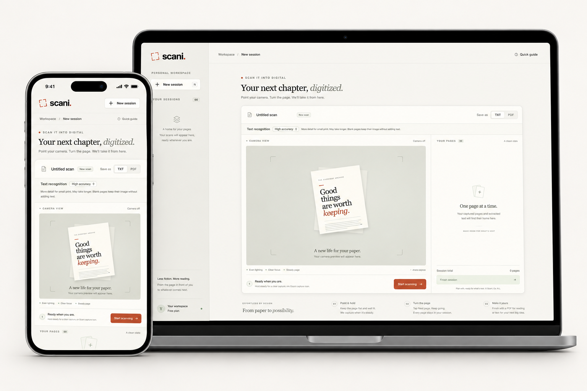

<br>
<br>
<h1 align="center">Scani</h1>
<br>
<br>
<br>
<p align="center">A quiet workspace for turning books and loose pages into a PDF or editable text. Built with Angular 20, Express, WebSocket progress, and server-side Tesseract OCR. All product copy and code are in English.</p>
<br>
<br>
<p align="center">
    
</p>
<br>

## License

Scani is licensed under the [PolyForm Noncommercial License 1.0.0](LICENSE). Use, modification, and redistribution are allowed for the purposes permitted by that license, including noncommercial use. Commercial uses outside those permissions require a separate license from the copyright holders. Dependencies and bundled third-party software retain their own licenses.

## Run with Docker

Requires **Docker Engine or Docker Desktop** and **Docker Compose v2 or newer**. The Bash scripts run from any working directory. Node.js 24, npm, Angular compilation, checks, tests, and OCR run inside containers; Node and npm are not required on the host. The first build and the first OCR language download require internet access.

```bash
cp .env.example .env
./RUN.dev.sh
```

Open **http://localhost:4200** on the host. The development stack contains Angular with live reload, the API/OCR worker, and Caddy for HTTPS. Changes in `frontend/` and `server/` are mounted into the container. Re-run `./RUN.dev.sh` after changing dependencies or root build configuration. Dependencies stay inside the image; host `node_modules/` is not used.

For production:

```bash
./BUILD.sh
docker compose up -d --wait
# http://localhost:3000, or the configured HTTPS address
```

`compose.yaml` uses project **scani** and `compose.dev.yaml` uses **scani-dev**, with separate containers, networks, scans, and certificate volumes. Both default to HTTPS port 8443, so choose another development HTTPS port when running both stacks:

```bash
./RUN.dev.sh -p 4201 --https-port 8444
```

Compose reads `.env` without executing it as shell code. Exported shell variables override `.env`. Configure `SCANI_ADDRESS` (default `localhost`), production ports `SCANI_PORT`/`SCANI_HTTPS_PORT` (3000/8443), development ports `SCANI_DEV_PORT`/`SCANI_DEV_HTTPS_PORT` (4200/8443), and `OCR_LANGUAGES` (default `eng+spa`). `SCANI_ADDRESS` must be a single hostname or IP without a scheme, path, or port. The application listens on all interfaces **inside** its container; plain HTTP is published only on host loopback. The trusted Caddy proxy provides LAN access over HTTPS.

## Shell scripts

| Command | Behavior |
| --- | --- |
| `./BUILD.sh` | Build `scani:local` using the production Dockerfile target. Checks, tests, and the Angular build run in build stages. Supports `--no-cache` and `--pull`. |
| `./RUN.dev.sh` | Build and start the development stack, then wait for app health. Supports `-p PORT`, `--https-port PORT`, `--status`, `--logs`, `--stop`, and `--reset`. |
| `./EXPORT.sh` | Build production, pull the Caddy image if missing, and package both images plus deployment configuration in `exports/scani-docker-<timestamp>-<pid>.tar.gz`. |
| `./CLEAN.sh` | Run `npm run clean` to remove host dependencies, builds, exports, and local caches (including OCR models). Remove both project stacks when Docker is available. Keep scans, Docker volumes, `.env`, and `package-lock.json`. `--images` also removes the two Scani image tags. Run `npm ci` before using Node locally again. |

`npm run clean` performs only the local file cleanup and does not require Docker. It preserves scans and configuration and leaves the shared npm cache untouched. `./RUN.dev.sh --stop` preserves all development data. `./RUN.dev.sh --reset` deletes development volumes, including scans, OCR caches, and Caddy certificates, after confirmation. `./CLEAN.sh --reset` deletes host `data/` as well as volumes for **both production and development** when Docker is available. Pass `--yes` explicitly to accept a reset without an interactive prompt. If Docker is unavailable, the script reports that Docker cleanup was skipped. Cleaning never runs a global Docker prune or removes unrelated images or volumes.

To stop production while keeping data:

```bash
docker compose stop
```

## Export and deploy Docker images

```bash
./EXPORT.sh
```

The bundle contains `images.tar` (`scani:local` and `caddy:2-alpine`), `compose.yaml`, `Caddyfile`, `.env.example`, `LICENSE`, and this README. It excludes scans, OCR caches, `.env`, certificate keys, and Docker volume contents. The application source and development scripts are not included. Exported images use the build machine's architecture; build separately for a different target architecture.

On another machine with Docker and Compose:

```bash
mkdir scani
# Replace the filename with your exported bundle.
tar -xzf /path/to/scani-docker-TIMESTAMP-PID.tar.gz -C scani
cd scani
docker load -i images.tar
cp .env.example .env
# Edit SCANI_ADDRESS and ports in .env for the target machine.
docker compose up -d --no-build --pull never --wait
```

No Node installation or image build is needed on the target. Back up or transfer volumes separately to migrate existing sessions. Scans created by earlier direct Node runs in host `data/` are not imported automatically. The OCR models still need a first download unless they have been preloaded into the scans volume.

## HTTPS for a phone or another LAN device

Browsers require a secure context for camera access. `http://192.168.x.x` does not qualify, even on the same Wi-Fi; the `localhost` exception applies only to the device running the browser. See [MDN: getUserMedia security requirements](https://developer.mozilla.org/en-US/docs/Web/API/MediaDevices/getUserMedia#security).

Caddy runs in Docker in both stacks; no host Caddy installation is needed:

1. Set `SCANI_ADDRESS` in `.env` to your server's LAN IP, preferably reserved in your router:

   ```dotenv
   SCANI_ADDRESS=192.168.1.50
   SCANI_HTTPS_PORT=8443
   SCANI_DEV_HTTPS_PORT=8443
   ```

2. Start development with `./RUN.dev.sh`, or production with `./BUILD.sh` followed by `docker compose up -d --wait`. Allow inbound TCP port 8443 from your LAN in the host firewall. No router port forwarding is required.

3. Copy the public root CA certificate from the running Caddy container. For development:

   ```bash
   docker compose -f compose.dev.yaml cp caddy:/data/caddy/pki/authorities/local/root.crt /tmp/scani-dev-root.crt
   ```

   For production:

   ```bash
   docker compose cp caddy:/data/caddy/pki/authorities/local/root.crt /tmp/scani-root.crt
   ```

4. Transfer the public `root.crt` file to the client device, install it, and enable trust for it. Transfer only the certificate, never private keys. On iOS/iPadOS, enable full trust under **Settings → General → About → Certificate Trust Settings** after installing the profile. Other devices/browsers may use a separate certificate store. See [Caddy's local HTTPS documentation](https://caddyserver.com/docs/automatic-https#local-https) and [Apple's certificate trust instructions](https://support.apple.com/en-us/102390).

5. Open **https://192.168.1.50:8443** on the phone and grant camera permission. The certificate must be trusted without warnings. If you changed the HTTPS port, use that port in the URL.

Production and development have separate CAs; trust the certificate for the stack you use. Caddy retains its CA across stops/rebuilds in its data volume. A reset deletes it, so install the new root certificate afterward. Caddy forwards API requests and WebSocket upgrades; the frontend automatically uses `wss://` for HTTPS. The backend's `TRUST_PROXY=1` is set by Compose for this trusted proxy setup. If camera access still fails, check that `window.isSecureContext` is `true`, then check browser permissions and whether another application is using the camera.

If connecting by IP gives `ERR_SSL_PROTOCOL_ERROR`, check that `SCANI_ADDRESS` matches the IP in the URL. The Caddyfile sets `default_sni` to this address so clients that omit SNI can receive the correct certificate even behind Docker's port mapping. After changing the Caddyfile, restart Caddy with `docker compose -p scani-dev -f compose.dev.yaml restart caddy` (production: `docker compose restart caddy`). After changing `.env`, re-run `./RUN.dev.sh` for development or `docker compose up -d --wait` for production. To check the TLS connection separately from certificate trust, run `curl -vk https://192.168.1.50:8443/`, substituting your configured address and port. A certificate trust warning requires installing the root CA as described above.

## Scan a document

1. Name the session and choose TXT or PDF.
2. Click **Start scanning** and grant camera permission. A rear camera is preferred. A device selector appears if multiple cameras are available.
3. Place a flat, well-lit page within the corner guide. The app checks lighting, text detail, movement, and 0.9 seconds of stability before capturing. Tap **Capture now** to capture manually without waiting for these checks.
4. Review the image and extracted text. Use **Improve text** to take another photo of the same full page and automatically merge its OCR readings, up to 10 captures per page. Wait for processing, then repeat as needed. The page keeps its position and original image, including in PDF downloads; TXT uses the combined text. Word readings are aligned and voted by OCR confidence, so additional captures can improve recognition but do not guarantee accuracy. Captures with substantially different text are rejected. Combine captures before saving manual corrections, which are protected from subsequent merges. **Rescan page** replaces the image and text and resets the capture count. Both actions work in finished sessions. Turn to the next page, then click **Next page**. Capture stays locked between pages to prevent duplicates.
5. Click **Finish session**, then download. Both formats are available regardless of the original selection. Session history in this browser lets you resume unfinished scans or reopen finished ones.

Reloading restores the active session and selected page from the server, including its name, output format, saved text, and completion status. Click **Resume scanning** to reopen the camera. Starting a new session clears the active selection so reloading does not reopen an older scan. Session links and the active selection are stored in this browser; images and OCR text remain on the server.

**TXT** contains editable Unicode OCR text in scan order, separated by form feeds. **PDF** preserves the scanned page images at their aspect ratio; it does not contain a searchable text layer. Text corrections apply to TXT. OCR confidence is an estimate; review important text.

## Camera and OCR behavior

Continuous focus, exposure, and white balance are requested only when the camera exposes those controls. Bright paper on a dark surface can be cropped automatically; otherwise the app uses the visible guide. This is a lightweight brightness detector, not perspective correction, book dewarping, or guaranteed page recognition. Curved pages, glossy paper, diagrams, small print, and movement can reduce quality or prevent capture. Flatten the page, move closer, or improve the light. While scanning, tap **Capture now** to capture manually without waiting for the lighting, sharpness, or stability checks. Manual capture uses the same crop, OCR, and saving flow as automatic capture.

Camera frames are analyzed locally. Only each captured JPEG is uploaded over HTTP; a session-scoped WebSocket reports OCR progress. Sending a continuous video stream is unnecessary for this workflow. HTTP still completes if live progress is unavailable.

Tesseract runs on your server. On first use it downloads configured language models and caches them under `data/ocr-cache`. Images and extracted text are never sent to an external OCR API. For offline operation, pre-download the configured `.traineddata.gz` models and set `OCR_LANG_PATH` to their directory. For Docker offline operation, put models in `/app/data/languages` inside the scans volume and set `OCR_LANG_PATH=/app/data/languages` in `.env`. Host filesystem paths are not mounted automatically. Change `OCR_LANGUAGES` to supported Tesseract language codes as needed.

The OCR engine begins loading when a session is created or reopened, while you position the first page, and stays loaded between pages. Recognition defaults to **High accuracy**, using a grayscale copy up to 2200 pixels wide; the saved image and PDF retain the original scan resolution (up to 2200 × 3000). Choose **Faster** in the recognition selector to cap the OCR copy at 1600 pixels. `OCR_MAX_WIDTH` sets the server limit (800–2200, default 2200). After changing `.env`, restart the stack with `./RUN.dev.sh` (production: `docker compose up -d --wait`). This can improve recognition detail at the cost of processing time. The first model download still depends on the network and is only needed once per language cache.

Blank-page detection runs before OCR and before any contrast adjustment, so paper grain and smooth shadows are less likely to become random letters. Detected blank pages retain their image and page position with empty text. Dark frames and uncertain nonblank results are not silently treated as blank. Nonblank OCR below `OCR_MIN_CONFIDENCE` (default 45, range 0–100) is rejected with a retry message; the captured photo remains in the queue. Increase this threshold to be stricter, at the cost of rejecting more real text. Detection remains heuristic; review sparse or faint text, diagrams, and low-confidence results.

## Storage and deployment

Session metadata, text, and JPEGs persist under `/app/data/<session-id>/` in the Docker `scans` volume (`scani_scans` in production, `scani-dev_scans` in development). Browser storage contains session IDs and page metadata, not images or OCR text. Back up the scans volume; deleting a session removes its files. Clearing browser storage loses the history links, although server files remain. Limits: 100 sessions, 100 pages per session, 12 MB per image, and four outstanding OCR jobs. One worker serializes recognition to bound CPU usage. Use one server process per data directory; locks are in-process.

This is a personal workspace without account authentication. Session IDs are unguessable access links, not a substitute for user accounts. Do not expose it publicly without an authenticated gateway. Follow [HTTPS for a phone or another LAN device](#https-for-a-phone-or-another-lan-device) for camera access over the network. Use one app container per scans volume; OCR serialization and session locks are in-process.

## Development and validation

```bash
./RUN.dev.sh
# Run validation inside the running development container:
docker compose -f compose.dev.yaml exec app npm test
docker compose -f compose.dev.yaml exec app npm run check
docker compose -f compose.dev.yaml exec app npm run build
# Or validate and build the production image:
./BUILD.sh
```

Direct Node development remains available for contributors with Node.js 22.12+ (24 LTS recommended): `npm ci`, `npm run dev`, `npm test`, `npm run check`, and `npm run build`. These npm commands do not automatically load `.env`; set environment variables explicitly. Direct Node defaults to `HOST=127.0.0.1`, `PORT=3000`, `DATA_DIR=./data`, and no proxy trust. This is optional; the shell scripts use Docker exclusively.

The source is organized by responsibility:

| Location | Responsibility |
| --- | --- |
| `frontend/src/app/app.ts` and `app.html` | UI state, session actions, and presentation. |
| `frontend/src/app/api.ts` and `session.ts` | HTTP requests, session types, and browser session metadata. |
| `frontend/src/app/camera.ts` and `capture.mjs` | Camera controls, JPEG capture, image analysis, and capture locking. |
| `server/index.mjs` and `store.mjs` | API routes, durable storage, and session mutation locks. |
| `server/progress.mjs` and `export.mjs` | Session-scoped WebSocket progress and TXT/PDF downloads. |
| `server/ocr.mjs` and `ocr-worker.mjs` | Bounded OCR queue and isolated recognition engine. |
| `scripts/` | Shared Docker shell helpers and backend syntax checks. |
| `tests/` | Node tests for capture, persistence, exports, OCR shutdown, and Docker scripts. |

See [AGENTS.md](AGENTS.md) for contributor guidance.

Before release, test on a real camera: permissions denied, device changes, dark/blurred pages, moving pages, duplicate prevention, multiple pages, rescanning an earlier page, text corrections, session recovery after restart, and both downloads. Automated tests cannot verify physical camera autofocus or real-world OCR accuracy.
